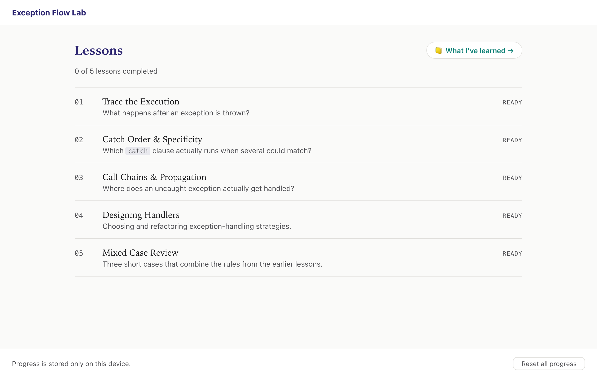
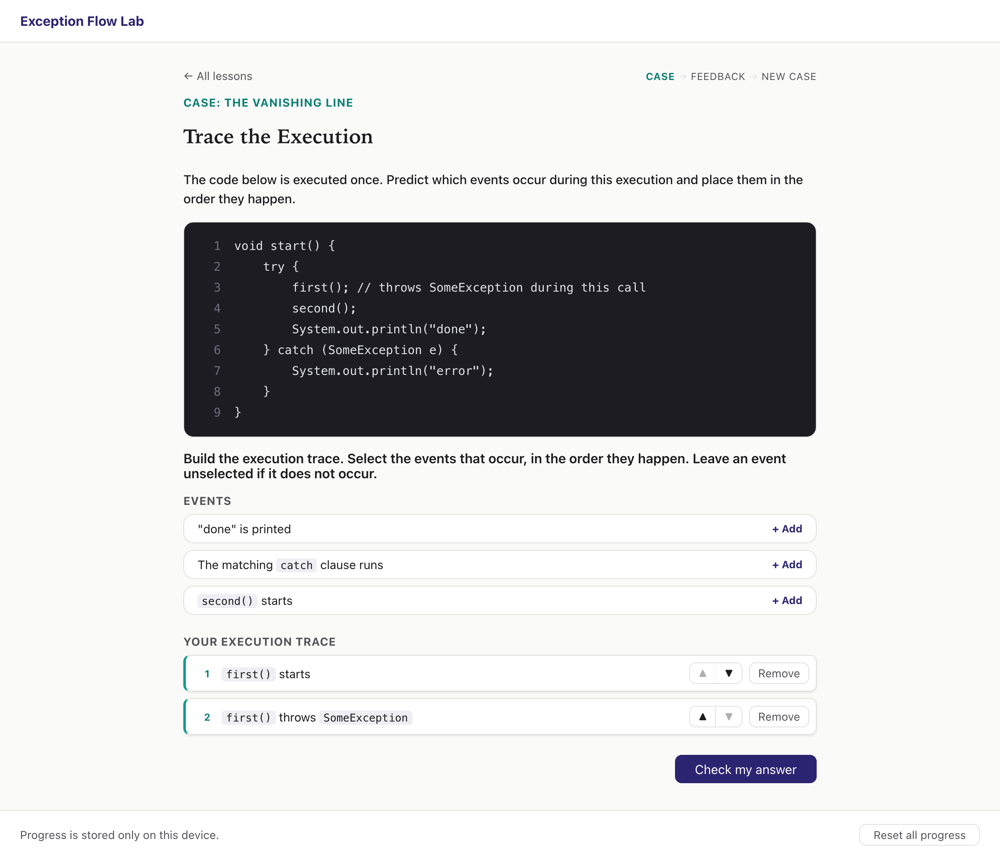
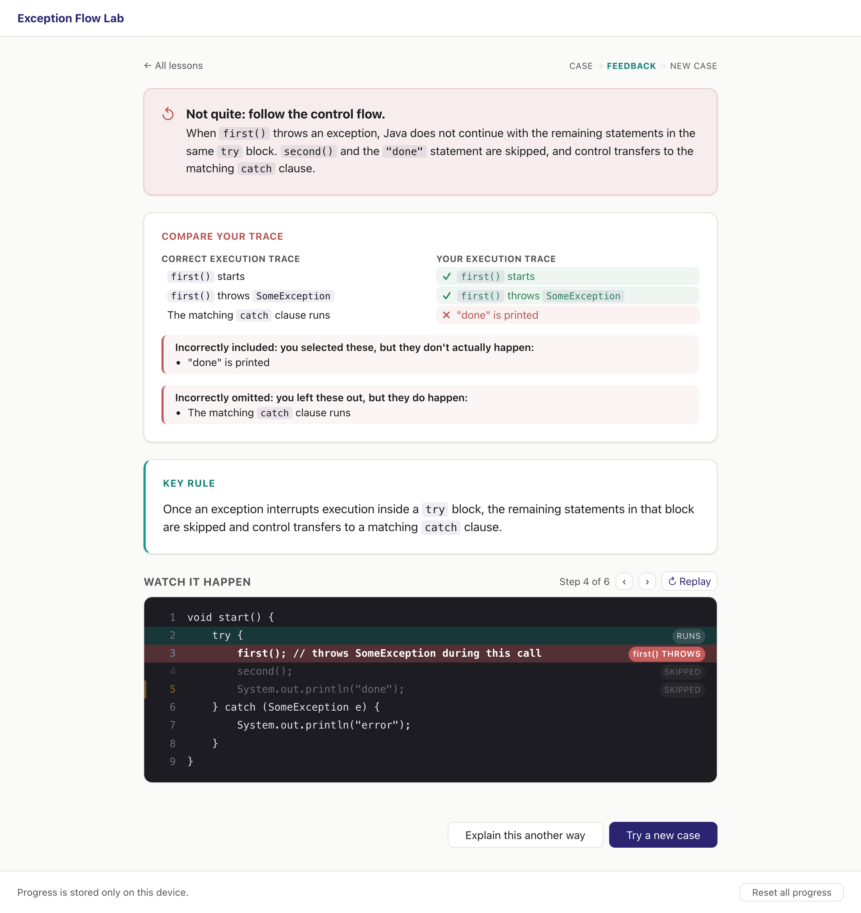

# Exception Flow Lab

A web-based learning tool that helps students recognise and correct common misconceptions about exception handling in Java.

Learners work through short code cases, predict what the code does, and get feedback that shows exactly where their reasoning went wrong. An optional LLM-based support panel can rephrase explanations, but correctness is always checked against predefined answers, never by the model.

Built as part of the thesis *LLM-Supported Learning Tool Addressing Java Exception Handling Misconceptions*.



## Lessons

| # | Lesson | Focus |
|---|--------|-------|
| 1 | Trace the Execution | Which statements run after an exception is thrown |
| 2 | Catch Order & Specificity | Which `catch` clause runs when several could match |
| 3 | Call Chains & Propagation | Where an uncaught exception is finally handled |
| 4 | Designing Handlers | Choosing and refactoring exception-handling strategies |
| 5 | Mixed Case Review | Short cases that combine the rules from lessons 1 to 4 |

Each lesson starts with a diagnostic case, followed by feedback, an optional AI explanation, a transfer case and a short retrieval question.

## Screenshots

**Solving a case.** The learner builds an execution trace from the events that actually happen.



**Feedback.** The answer is compared with the correct trace, and a step-by-step replay shows which lines run and which are skipped.



## Getting started

Requires Node.js 18 or newer.

```bash
npm install
npm run dev
```

The app runs at `http://localhost:5173`. Progress is stored in the browser's `localStorage`; there is no backend or login.

Other scripts:

```bash
npm run build      # type-check and build to dist/
npm run preview    # serve the production build
```

## LLM support (optional)

Two features use Google's Gemini API: the AI support panel and the feedback on retrieval questions. Without an API key, the app falls back to predefined content and works normally.

**Local development**

```bash
cp .env.example .env.local
# then set VITE_GEMINI_API_KEY in .env.local
```

A free key is available at [aistudio.google.com/apikey](https://aistudio.google.com/apikey). This key ends up in the client bundle, so use it only locally.

**Deployment (Vercel)**

`api/gemini.ts` is a serverless proxy that keeps the key on the server. Set these environment variables in the Vercel project:

| Variable | Description |
|----------|-------------|
| `GEMINI_API_KEY` | Gemini API key |
| `ACCESS_CODES` | Comma-separated access codes, e.g. `pilot-a,pilot-b` |
| `GEMINI_MODEL` | Optional, defaults to `gemini-3.6-flash` |

Testers open the app with `?code=<access-code>` in the URL. Visitors without a valid code get the predefined content.

## Project structure

```
api/              Vercel serverless proxy for Gemini
src/
  components/     Screens and UI components
  content/        Lesson content: tasks, answers, feedback, replay scripts
  llm/            Gemini client and the two LLM-backed services
  state/          Screen state machine, answer evaluation, progress storage
  types/          Shared TypeScript types
```

New tasks are added in the matching file under `src/content/` and registered in `src/content/modules.ts`.

## Tech stack

React, TypeScript, Vite, CSS Modules, dnd-kit, Google Gemini API.
